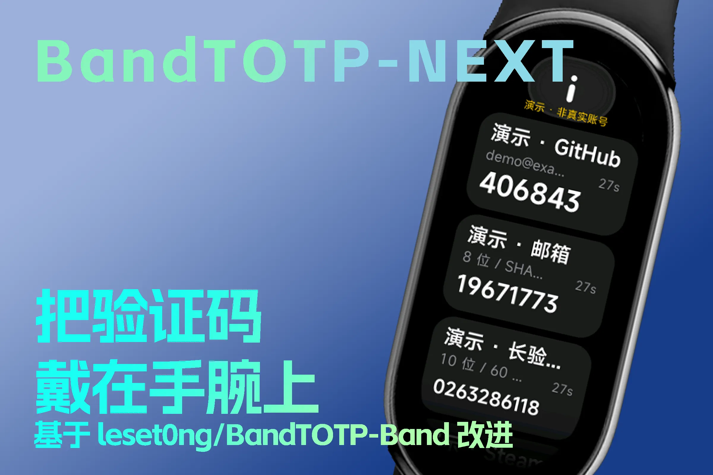

# BandTOTP-NEXT



小米手环 9（Vela 快应用）的 TOTP 验证器改进版，支持 **Aegis 备份导入**、**多算法**、**多位验证码** 与 **自定义周期**。

基于 [leset0ng/BandTOTP-Band](https://github.com/leset0ng/BandTOTP-Band)（MIT）重写增强，本版本由 ymh0000123 维护。手环快应用包名为 `com.ymh0000123.bandtotp.next`。

## 功能

### 手环端

- 令牌类型：TOTP、Steam、HOTP、Yandex、mOTP
- 哈希算法：SHA1、SHA256、SHA512、MD5
- 验证码位数：1 ~ 10 位（常见 6/7/8 位；Steam 使用 5 位字母表）
- 每个条目独立的周期（1 ~ 86400 秒）与倒计时
- 列表展示名称、账号与剩余秒数，详情页展示完整算法、位数与周期
- 详情页展示完整参数、自适应进度环；HOTP 支持“下一码”
- 双击确认删除，降低手环误触
- 导入格式：
  - Aegis 明文导出 / 数据库 JSON
  - 旧版 `{"list":[...]}` 载荷
  - `otpauth://` 链接（totp / steam / hotp / yaotp / motp）
  - Google Authenticator `otpauth-migration://` 迁移码
  - Aegis 加密备份会被识别并提示先用配套工具或同步 App 解密
- 旧版 storage 数据自动迁移，默认 SHA1 / 6 位 / 30 秒

### 同步 App（Android，Miuix）

- 使用 [Miuix](https://github.com/miuix-kotlin-multiplatform/miuix) 组件库，HyperOS 风格界面
- **分享导入**：在 Aegis 中选择导出/备份后分享到本应用，或直接打开 `.json`
- **解密全部在手机端完成**：scrypt + AES-256-GCM，密码不保存、不上传
- 条目预览与逐条勾选：默认全选，可点选或“全不选”，只把选中的令牌发送到手环
- 也支持分享 `otpauth://` 文本，App 会把原文交给手环端解析
- 无网络权限，`allowBackup=false`

### 配套工具

- `tools/aegis2band.js`：Node.js 命令行，解密 Aegis 加密备份并生成
  `.band.json`（完整载荷）与 `.otpauth.txt`（兼容旧手机客户端）
- `tools/aegis-import.html`：单文件浏览器工具，纯前端 scrypt + WebCrypto 解密，
  不上传任何数据

## 目录结构

```
BandTOTP-NEXT/
├── src/                       # Vela 快应用源码
│   ├── app.ux
│   ├── manifest.json          # 手环快应用配置（包名 com.ymh0000123.bandtotp.next）
│   ├── config-watch.json
│   ├── common/                # 图标与界面图片
│   └── pages/index/
│       ├── index.ux           # 手环界面与业务逻辑
│       ├── totp.js            # OTP 引擎
│       └── importers.js       # Aegis / otpauth / 迁移码解析
├── sign/                      # 本地签名材料目录（certificate.pem / private.pem，不入库）
├── dist/                      # 构建生成的签名 RPK（不入库）
├── docs/
│   └── cover.webp             # README 介绍封面（3:2）
├── package.json               # crypto-js 依赖
├── .github/workflows/
│   └── release.yml            # 发布 Release 时自动构建 RPK 与 APK
├── tools/
│   ├── aegis-core.cjs         # Aegis 解密核心（Node）
│   ├── aegis2band.js          # 命令行转换工具
│   ├── aegis-import.html      # 浏览器导入工具
│   └── generate-brand-assets.py  # 生成图标与封面
├── sync-app/                  # Android 同步 App（Miuix）
│   ├── app/src/main/java/com/ymh0000123/bandtotp/next/
│   │   ├── MainActivity.kt    # 分享 Intent 入口
│   │   ├── AegisBackup.kt     # 本机解密 + 条目转换
│   │   ├── SyncViewModel.kt   # 设备、导入、发送状态
│   │   ├── BandEntry.kt       # 手环载荷模型
│   │   └── ui/SyncScreen.kt   # Miuix 界面
│   ├── keystore.properties.example # 本地签名配置示例
│   └── app/src/test/...       # JVM 单元测试
├── tests/run-tests.cjs        # 手环端算法/解析/解密测试
└── LICENSE
```

## 构建

### 手环端（AIoT-IDE）

1. 安装 [Xiaomi AIoT-IDE](https://iot.mi.com/vela/quickapp/)。
2. 打开本项目根目录。
3. 在 IDE 终端执行 `npm install`（安装 `crypto-js`）。
4. 点击“调试”在模拟器验证。
5. 将你自己的 `certificate.pem` 与 `private.pem` 放入 `sign/`，然后执行
   `aiot release`，生成
   `dist/com.ymh0000123.bandtotp.next.release.2.1.0.rpk`。
   签名材料不会随仓库提供，也不会入库。
6. 用 AstroBox 或表盘自定义工具安装到手环。

> 若改用其他工具打包，可将 `build/` 与 `sign/` 一起放到临时目录执行
> `aiot resign`，同样会生成签名 RPK。

> 若打包工具没有自动收集 `node_modules`，请确认 AIoT-IDE 的依赖安装已完成。
> 手环端依赖 `crypto-js` 的 HmacSHA1/HmacSHA256/HmacSHA512/HmacMD5 与 MD5。

#### 模拟器演示令牌

先停止 IDE 中正在运行的调试，在项目根目录终端执行：

```bash
npm run demo
```

按终端提示选择已创建的模拟器。演示启动参数为 `pages/index?demo=1`，
会加载 5 条公开测试密钥生成的虚假验证器：6 位 TOTP、8 位 SHA256、
10 位 SHA512 / 60 秒、Steam、HOTP。列表显示黄色“演示 · 非真实账号”标识，
可测试倒计时、详情、下一码和双击删除；重新启动演示会恢复全部条目。

- 演示模式不读取或写入真实 storage，也不连接手机互联接口、不接收导入消息。
- `npm run demo:build` 仅构建演示包，不启动模拟器。
- 演示产物独立输出到 `build-demo/` 和 `dist-demo/`，**不要安装到实机**。
- 演示启动已兼容仅配置 `image.sysdir.1` 的新版 IDE 模拟器，避免旧工具链误报
  `this emulator is unavailable`；无需修改 SDK 配置或重新创建模拟器。
- 退出演示终端命令后，普通 IDE 调试和 `aiot build` / `aiot release` 不会自动启用演示。
  请使用 `dist/` 中的正常构建包进行实机测试和发布。
- 此模式通过显式参数开启，不依赖“接口失败”或开发包来猜测模拟器环境。

### 同步 App（Android Studio）

1. 用 Android Studio 打开 `sync-app/` 目录。
2. 使用 JDK 17。
3. 构建环境：Gradle 9.5.0、AGP 9.3.3、compileSdk 37、Miuix 0.9.3。
   - Android Studio 可自动下载 Gradle 9.5.0；国内网络可在
     `sync-app/gradle/wrapper/gradle-wrapper.properties` 中改用镜像。
4. 构建 `:app:assembleRelease`。
5. 构建产物在 `sync-app/app/build/outputs/apk/release/`。仓库不包含签名密钥和
   现成 APK；请复制 `sync-app/keystore.properties.example` 为
   `sync-app/keystore.properties`，填入你自己的密钥库信息后再构建。

同步 App 发送消息到快应用 `com.ymh0000123.bandtotp.next` 的 `pages/index`。
首次使用请允许蓝牙权限，并在小米运动健康中保持手环连接。

### GitHub Actions 自动构建

`.github/workflows/release.yml` 会在**发布 Release**时自动构建两个产物并附加到该 Release：

- `BandTOTP-NEXT-<版本>.rpk`：手环快应用
- `BandTOTP-NEXT-Android-<版本>.apk`：同步 App

也可以在 Actions 页面手动运行 `Release Build` 并填写版本号；手动运行只把产物
保存为 workflow artifact，不会创建或修改 Release。

首次使用前，在仓库 **Settings → Secrets and variables → Actions** 添加以下
repository secrets：

| Secret | 内容 |
| --- | --- |
| `VELA_CERT_PEM` | 手环签名证书 `certificate.pem` 全文 |
| `VELA_PRIVATE_PEM` | 手环签名私钥 `private.pem` 全文 |
| `ANDROID_KEYSTORE_BASE64` | Android 密钥库文件的 Base64（单行，无换行） |
| `ANDROID_KEYSTORE_PASSWORD` | 密钥库密码 |
| `ANDROID_KEY_ALIAS` | 密钥别名 |
| `ANDROID_KEY_PASSWORD` | 密钥密码 |

生成密钥库 Base64：

```bash
# Git Bash / Linux / macOS
base64 -w0 sync-app/keystore/your-keystore.p12
```

```powershell
# PowerShell
[Convert]::ToBase64String([IO.File]::ReadAllBytes("sync-app\keystore\your-keystore.p12"))
```

版本号取自 Release tag（去掉开头的 `v`）；Android `versionCode` 按
`major * 10000 + minor * 100 + patch` 计算，手环端同步写入 `src/manifest.json`，
Android 端通过 `-PappVersionName` / `-PappVersionCode` 传入。tag 不是
`x.y.z` 时回退到 `package.json` 的版本。

> 签名材料仅在 workflow 运行时从 secrets 写入临时文件，构建后立即删除，不会
> 进入仓库或构建产物。本 workflow 不在 Pull Request 上触发，fork 的 PR 无法
> 读取这些 secrets。

## 使用方式

### 方式一：同步 App（推荐）

1. 在 Aegis 中打开“导出”或“备份”，生成 JSON 文件。
2. 在文件管理器/Aegis 中选择“分享”，分享到 **BandTOTP-NEXT**。
3. 如果是加密备份，输入密码；App 在本机完成 scrypt + AES-GCM 解密。
4. 勾选要同步的条目（默认全选），点击“发送到手环”。
5. 手环端会自动合并：相同密钥与参数的条目更新，不重复添加。

### 方式二：旧版 BandTOTP 手机客户端 / AstroBox 插件

```bash
# 推荐用环境变量传密码，避免留在 shell 历史
AEGIS_PASSWORD='你的密码' node tools/aegis2band.js aegis-backup.json

# 或交互输入（不会回显）
node tools/aegis2band.js aegis-backup.json
```

生成：

- `bandtotp.band.json`：完整载荷（含 Steam/HOTP/Yandex/mOTP 与全部参数）
- `bandtotp.otpauth.txt`：otpauth 链接，旧客户端可直接读取其中的 TOTP 条目

输出文件固定写入当前工作目录。

> 旧版 BandTOTP-Android / AstroBox 插件只识别 `otpauth://totp/...`，并且发送目标
> 是旧包名 `com.lst.bandtotp`。若要配合本项目的快应用，请使用上文的同步 App；
> 本工具生成的 `.otpauth.txt` 仍可用于旧快应用。
> SHA256/SHA512、8 位、自定义周期都能正常携带；Steam/HOTP/Yandex/mOTP
> 会被旧客户端忽略，请使用 `.band.json` 或同步 App。

`<Aegis备份.json>` 只能写文件名，不能带目录；文件需位于 `--input-dir`
（默认当前目录）内，可用 `--input-dir ~/Downloads` 指定其他目录。

### 方式三：浏览器工具

直接用浏览器打开 `tools/aegis-import.html`：

1. 拖入 Aegis 备份 JSON。
2. 加密备份输入密码，点击“解密并解析”。
3. 下载 `.band.json` 或 `.otpauth.txt`。

所有计算在本地浏览器完成；页面 CSP 禁止网络请求。

### 方式四：直接发送 Aegis 明文 JSON

手环端也接受完整 Aegis 明文导出（`{"version":1,"header":...,"db":{...}}`）
或数据库对象（`{"version":3,"entries":[...]}`）。任何能通过
`system.interconnect` 发送 JSON 的工具都可以直接导入。

## Aegis 兼容性

| 能力 | 支持 | 说明 |
| --- | --- | --- |
| TOTP | ✅ | SHA1 / SHA256 / SHA512 / MD5，1~10 位，自定义周期 |
| Steam | ✅ | 5 位 Steam 字母表 |
| HOTP | ✅ | 详情页手动递增计数器 |
| Yandex | ✅ | 需要 PIN；26 字节 secret 使用前 16 字节 |
| mOTP | ✅ | 需要 PIN；固定 MD5 / 6 位 / 10 秒 |
| Aegis 明文导出 | ✅ | 手环 / App / CLI / HTML |
| Aegis 加密备份 | ✅ | App、CLI、HTML 解密；手环端不参与解密 |
| Google 迁移码 | ✅ | 手环端解析 `otpauth-migration://` |
| note / icon / groups | — | 手环端不展示，仅保留令牌本身 |

Aegis 加密备份格式：密码槽使用 `scrypt(N=32768, r=8, p=1) + AES-256-GCM`，
数据库使用主密钥 `AES-256-GCM`；slot 字段为十六进制，`db` 为 Base64。
实现参考 Aegis 的公开备份格式，未复制其源代码。

## 安全说明

- **手环端 storage 以明文保存密钥**。这是 Vela 快应用的存储限制；手环丢失时
  存在密钥泄露风险，请为手环设置锁屏并妥善保管。
- 同步 App **不保存密码和备份内容**，`allowBackup=false`，没有申请网络权限，
  解密只在本机内存中完成。
- 浏览器工具不发起网络请求；解密结果只保存在当前页面内存。
- CLI 密码优先从 `AEGIS_PASSWORD` 环境变量读取；`--password` 可能留在命令历史。
- 导入文件限制 8 MiB，单条互联消息限制 200 KiB，避免异常输入导致内存问题。
- 所有外部输入都会校验类型、位数、周期、scrypt 参数与十六进制/Base64 格式。

## 测试

手环端与工具：

```bash
npm test
# 42 项：RFC 4226 / RFC 6238 官方向量、Steam/Yandex/mOTP 交叉验证、
# otpauth/Aegis/迁移码解析、Aegis 加密备份端到端、浏览器 scrypt 与 Node 对比
```

同步 App：

```bash
cd sync-app
./gradlew :app:testDebugUnitTest
# 7 项：加密备份解密、错误密码、明文备份、直接数据库、类型默认参数、issuer 拆分
```

## 已知限制

- HOTP 的计数器只在本地递增，无法与服务器自动同步。
- 旧版手机客户端只发送 TOTP 条目；完整类型请用同步 App 或 `.band.json`。
- 手环端破解 Aegis 加密备份需要 scrypt 32 MiB 内存，不适合在手表上执行，
  因此解密放在手机/桌面端。
- 发送大量条目时请留意互联消息大小（建议 100 条以内）。

## 许可

- 本项目基于 [BandTOTP-Band](https://github.com/leset0ng/BandTOTP-Band)，MIT。
- Miuix 组件库：Apache-2.0。
- 小米 Wearable SDK（`xms-wearable-lib_1.4_release.aar`）版权归小米，
  仅用于与小米手环通信。
- Aegis 备份格式与算法行为参考 [beemdevelopment/Aegis](https://github.com/beemdevelopment/Aegis)，
  本项目为独立实现，未包含其源代码。
